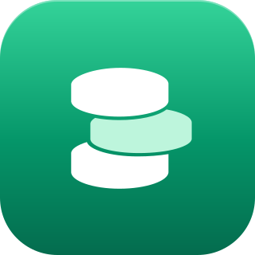
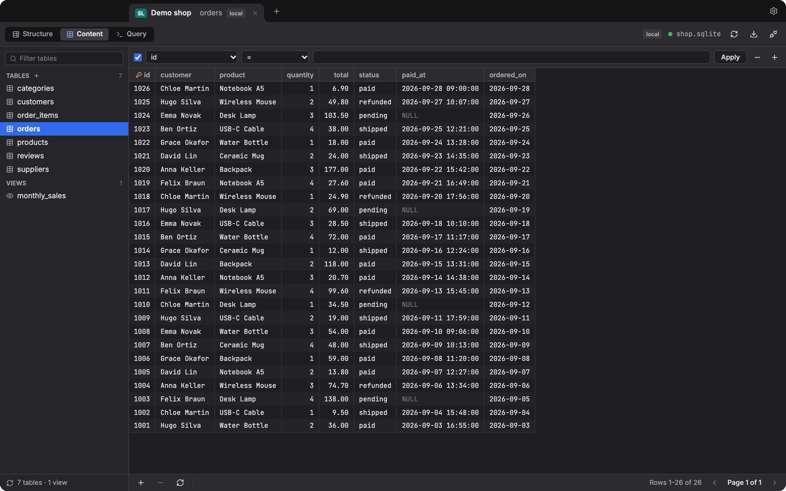

<p align="center">
  
</p>

<h1 align="center">SQL Pro</h1>

<p align="center">
  A small desktop SQL client, like Sequel Pro. It works with MySQL, PostgreSQL, SQL Server and SQLite.
</p>

<p align="center">
  
</p>

It is built with Tauri v2 (Rust backend) and Vue 3 + TypeScript (frontend).

## Install

**macOS and Linux**, in the Terminal:

```sh
curl -fsSL https://raw.githubusercontent.com/necessarylion/sql-pro/main/install.sh | sh
```

- macOS (Apple silicon and Intel): it puts `SQL Pro.app` in your Applications folder.
- Linux (64-bit Intel, AMD and ARM): it installs the `.deb` or the `.rpm` with the package manager of your system, and asks for your password. A system without `apt`, `dnf`, `yum` or `zypper` gets the AppImage in `~/.local/bin`.

**Windows** (64-bit Intel, AMD and ARM), in PowerShell:

```powershell
irm https://raw.githubusercontent.com/necessarylion/sql-pro/main/install.ps1 | iex
```

Run the same line again to update. The app is not signed, so install it with these lines.
A file you download with a browser from the [releases](https://github.com/necessarylion/sql-pro/releases) page (`.dmg`, `.msi`, `.exe`, `.deb`, `.rpm`, `.AppImage`) shows a warning on macOS and Windows.

## Run

```sh
bun install
bun run tauri dev
```

## Checks

```sh
bun run lint       # ESLint
bun run typecheck  # vue-tsc
bun run format     # Prettier
bun test           # Session logic with a fake backend
```

## Layout

```
src/
  main.ts          builds the objects and hands them to the components (provide/inject)
  types.ts         types shared with the backend
  constants/       all global constants
  services/
    DatabaseApi    the only file that calls the backend (Tauri invoke)
    Session        all state and logic of one tab
    SessionManager the list of tabs
    FavoriteStore  saved connections (passwords go to the OS keychain)
    keys           the injection keys
  components/      the views. They only show state and call Session methods.
  style.css        global colours, light and dark
src-tauri/         the Rust backend
```

The flow is: component -> `Session` -> `DatabaseApi` -> Rust command.
